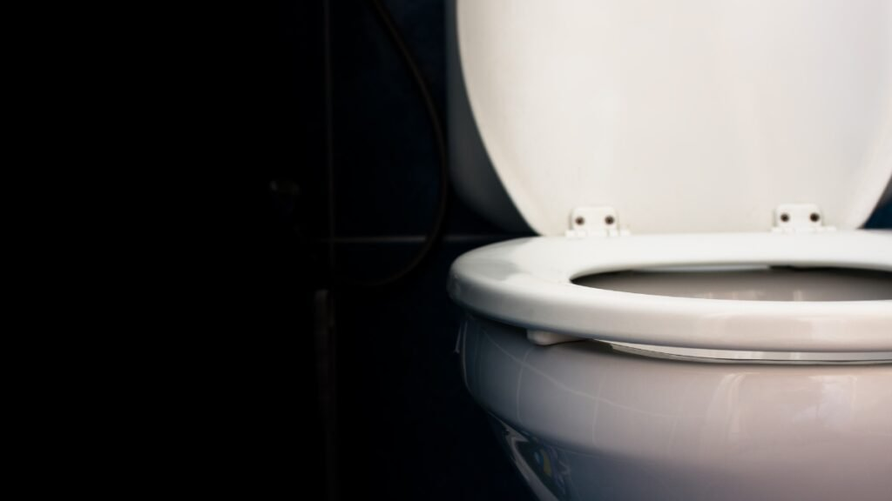

O banheiro é um dos espaços mais íntimos e importantes da nossa casa. É lá que começamos e terminamos o dia, buscando momentos de renovação. No **Irenes**, acreditamos que cada detalhe desse ambiente deve contribuir para a sua paz de espírito. Por isso, escolher o vaso sanitário ideal não é apenas uma questão técnica, mas um passo essencial para criar um santuário de harmonia e funcionalidade.

Se você está reformando ou construindo, este guia completo vai te ajudar a entender qual modelo melhor se adapta à sua rotina, garantindo beleza e praticidade.

## **Os Modelos de Vasos Sanitários: Qual Combina com seu Estilo?**

Existem diversas opções no mercado, e entender a diferença entre elas é o primeiro passo para uma escolha consciente.

### **1\. Vaso Sanitário com Caixa Acoplada**

Este é o modelo mais popular no Brasil. Sua principal vantagem é a **facilidade de manutenção**, já que o mecanismo de descarga fica acessível dentro da caixa. Além disso, muitos modelos têm duplo acionamento, com descarga parcial de cerca de 3 litros para líquidos e total de cerca de 6 litros para sólidos. Confira o volume no manual do fabricante.

-   *Dica da Irene:* Ideal para quem busca praticidade e quer evitar quebra-quebra na parede no futuro.

### **2\. Vaso Sanitário Convencional (com Válvula de Parede)**

É aquele modelo onde a descarga fica embutida na parede. Ele ocupa menos espaço físico, sendo excelente para **banheiros pequenos ou lavabos**. A estética é mais limpa, porém a instalação e a manutenção da válvula exigem mais cuidado com a tubulação. Esse modelo também depende de pressão adequada na rede de água. Fale com o encanador antes de escolher.

### **3\. Vaso Monobloco (One Piece)**

Se você busca o ápice da elegância, o vaso monobloco é a escolha certa. Nele, a bacia e a caixa formam uma única peça fundida. Além do design sofisticado, eles são **mais fáceis de limpar**, pois não possuem fendas ou emendas onde a sujeira possa se acumular.

### **4\. Vaso Sanitário Suspenso**

Moderno e minimalista, este modelo é fixado na parede e não toca o chão. Além do visual flutuante, ele deixa o piso livre e facilita a limpeza embaixo da peça. Mas exige planejamento: a bacia precisa de uma estrutura própria de aço, e em parede de drywall essa estrutura deve receber a carga, não apenas as chapas. Também é preciso prever acesso para manutenção da caixa embutida. Costuma custar mais para comprar e instalar, sobretudo se a parede exigir adaptações.

## **Comparativo Rápido dos Modelos**

| Modelo | Ponto forte | Atenção |
|---|---|---|
| Caixa acoplada | Instalação simples, sem quebrar a parede | Ocupa mais espaço para trás |
| Convencional (válvula) | Compacta, boa para lavabo | Depende da pressão da rede e da válvula |
| Monobloco | Visual limpo, poucas emendas | Peça única: confira medidas e peso |
| Suspenso | Piso livre e visual leve | Exige estrutura, acesso e obra planejada |

## **O Que Considerar Antes de Comprar? (Checklist)**

Para garantir que a paz reine na sua instalação, observe estes pontos:

-   **Distância do esgoto:** meça da parede acabada até o centro do ponto de esgoto. Para vasos com caixa acoplada, o padrão de muitos fabricantes é 30 cm. A espessura do rodapé ou do revestimento pode reduzir essa medida, e alguns manuais indicam valores próximos, como 30,5 cm. Confira o manual do modelo.
-   **Saída do esgoto:** veja se a saída da peça é horizontal ou vertical e se ela combina com o seu ponto de esgoto. Alguns modelos atendem às duas e trazem o conector.
-   **Medidas da peça:** meça largura, profundidade e altura, e deixe espaço livre à frente para sentar com conforto.
-   **Conforto ([ergonomia](https://beecorp.com.br/ergonomia/)):** existem vasos com alturas diferentes. Para pessoas mais altas ou com dificuldade de locomoção, modelos mais altos (linha "confort") ajudam. Teste sentando na loja, se possível.
-   **Mecanismo de descarga:** confira se tem duplo acionamento e se as peças de reposição são fáceis de achar.
-   **Normas:** pergunte se a linha atende à NBR 15097, que trata de aparelhos sanitários de material cerâmico.
-   **Cor e acabamento:** o branco é atemporal e passa sensação de limpeza. Cinza fosco e preto fosco são modernos, mas costumam exigir limpeza mais frequente para não marcar.
-   **Assento e acessórios:** nem sempre o assento acompanha a bacia. Veja o que vem no kit.

## **Erros Comuns na Compra do Vaso Sanitário**

-   Comprar pelo visual sem medir a distância do esgoto.
-   Medir a partir da parede sem acabamento, antes do reboco ou do revestimento.
-   Escolher um modelo suspenso sem prever estrutura e acesso à manutenção.
-   Esquecer a pressão da rede ao optar por válvula de descarga.
-   Não conferir se a descarga limpa bem: bacias que lavam mal causam sujeira e entupimento. Se isso já acontece, veja como [desentupir um vaso sanitário](/vaso-sanitario-entupido/).

## **Sustentabilidade: O Equilíbrio com o Planeta**

Cuidar da casa é também cuidar do mundo. Prefira bacias de volume de descarga reduzido, hoje comuns no mercado, com cerca de 6 litros por descarga. Antes disso era comum gastar 9 ou 12 litros. O duplo acionamento, quando disponível, permite usar a descarga parcial e economizar ainda mais. Prefira também bacias que limpem bem com esse volume, porque descarga repetida anula a economia.

## **Transforme seu Banheiro em um Refúgio de Paz**

Escolher o vaso sanitário certo é o alicerce para um banheiro funcional e bonito. Quando unimos a técnica com o cuidado estético, transformamos um item utilitário em parte da nossa decoração afetiva.

**Gostou dessas dicas?** Aqui no Irenes, queremos que você se sinta empoderada para fazer as melhores escolhas para o seu lar.

## **Perguntas Frequentes sobre Vaso Sanitário**

### Qual o melhor vaso sanitário para banheiro pequeno?

O convencional, com válvula, ocupa menos espaço por não ter caixa. O suspenso também libera o piso, mas exige estrutura e obra. Meça o espaço antes.

### Qual a distância padrão do esgoto até a parede?

Para vasos com caixa acoplada, muitos fabricantes indicam 30 cm da parede acabada até o centro do esgoto. Confira sempre o manual do modelo.

### Vaso suspenso precisa de obra?

Sim. Ele precisa de estrutura própria e de acesso para manutenção. Em drywall, a estrutura deve suportar a carga da peça.

### Duplo acionamento economiza água?

Ele permite usar uma descarga parcial para líquidos, em geral de cerca de 3 litros, em vez da total, de cerca de 6 litros.

### Posso trocar o vaso sem quebrar a parede?

Em geral, sim, se for trocar por um modelo com caixa acoplada compatível com o ponto de esgoto. Modelos suspensos costumam exigir obra.

**Leia também:**

- [como escolher, instalar e cuidar do box de vidro](/box-de-banheiro-de-vidro-guia-completo/)
- [como desentupir o vaso sanitário](/vaso-sanitario-entupido/)
- [prolongar a vida útil das estruturas hídricas](/como-prolongar-a-vida-util-das-estruturas-hidricas/)
- [o que fazer na primeira hora de uma emergência hidráulica](/emergencia-hidraulica-em-casa-guia-primeiras-horas/)
