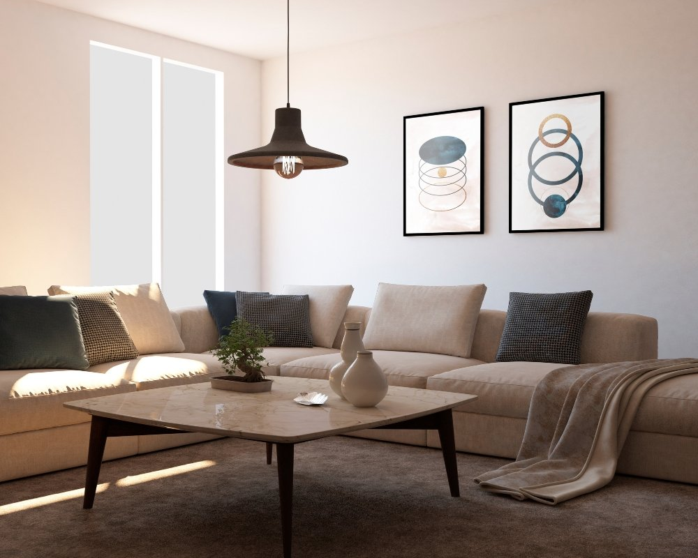

A **decoração de interiores** vai muito além de estética: ela organiza espaços, define rotinas e promove bem-estar. Ao planejar a transformação de um cômodo, é fundamental considerar a **paleta de cores**, a **iluminação**, o **mobiliário**, as **texturas** e a funcionalidade. Esses elementos, combinados com bom **planejamento de espaços** e controle de **orçamento**, tornam qualquer projeto viável e duradouro.

Este guia reúne o passo a passo para decorar qualquer ambiente, do planejamento aos detalhes. A ordem importa: primeiro o espaço, depois a luz e as cores, por último os objetos.

## Por onde começar: planejamento do espaço

Antes de comprar qualquer coisa, entenda o ambiente. Um planejamento simples evita a maior parte dos arrependimentos.

-   **Meça o cômodo** e desenhe uma planta simples, no papel ou em um aplicativo.
-   **Observe o fluxo de circulação:** por onde as pessoas passam e onde o espaço precisa ficar livre.
-   **Marque a luz natural:** onde ficam as janelas e em que horas o sol entra.
-   **Liste os usos do ambiente:** dormir, trabalhar, receber visitas, cozinhar.
-   **Decida o que fica e o que sai.** Decorar começa por tirar o que não funciona.

Mesmo em apartamentos compactos, pequenas escolhas, como a paleta e o tipo de iluminação, têm impacto direto na sensação de amplitude e acolhimento. A **decoração de interiores** eficiente prioriza conforto e praticidade, sem abrir mão da personalidade.

## Paleta de cores e texturas: escolher a base certa

A escolha da **paleta de cores** define o tom emocional do espaço. Tons neutros ampliam visualmente ambientes, enquanto cores saturadas criam pontos de destaque. Combine uma cor dominante suave com duas de apoio e uma cor de destaque para equilibrar o conjunto.

Uma regra prática usada por muitos designers é a proporção 60-30-10:

-   **60%** para a cor dominante, em paredes e grandes superfícies;
-   **30%** para a cor secundária, em sofá, cortinas ou tapete;
-   **10%** para o destaque, em almofadas, quadros e objetos.

É um ponto de partida, não uma lei. Ajuste conforme o seu gosto e a luz do ambiente.

As **texturas** complementam as cores e trazem profundidade: tecidos naturais, tapetes felpudos e acabamentos em madeira adicionam calor, enquanto superfícies lisas e metálicas entregam modernidade. Misturar duas ou três texturas evita que o ambiente fique plano.

Para renovar uma parede sem obra, o papel de parede é uma opção. Se for usar, [calcule a quantidade de rolos antes de comprar](/como-calcular-papel-de-parede/) e veja [como aplicar papel de parede adesivo](/como-aplicar-papel-de-parede-adesivo/).

Para quem busca uma decoração atemporal, invista em peças-chave em tons neutros e atualize o visual com mantas, almofadas e objetos coloridos. Essa estratégia reduz custos no longo prazo, porque renova o ambiente sem exigir grandes investimentos em mobiliário.

## Iluminação e funcionalidade: projetar para usar e sentir

A **iluminação** é um dos pilares da **decoração de interiores**, pois define a atmosfera e a usabilidade dos espaços. Pense em três camadas:

-   **Luz geral:** ilumina o ambiente como um todo.
-   **Luz de tarefa (focal):** reforça áreas de uso, como bancadas, mesas de trabalho e cantos de leitura.
-   **Luz decorativa:** cria clima, com abajures, fitas de LED e arandelas.

Cozinhas e escritórios exigem iluminação funcional e direta, enquanto salas de estar e quartos se beneficiam de luzes mais quentes e difusas para criar conforto. Como referência, a luz quente fica em torno de 2700 K a 3000 K e a luz neutra, em torno de 4000 K. A temperatura de cor vem indicada na embalagem da lâmpada.

Planejar pontos de luz próximos a áreas de leitura, mesas de trabalho e bancadas reduz o cansaço visual e aumenta a produtividade. Aposte em dimmers para controlar a intensidade e em lâmpadas com bom índice de reprodução de cor (IRC), que valorizam cores e texturas. A iluminação natural deve ser explorada ao máximo, ajustando cortinas e persianas para modular entrada de luz e privacidade.

## Mobiliário, conforto e orçamento: priorizar o essencial

O mobiliário precisa atender à rotina, priorizando ergonomia e durabilidade. Em projetos enxutos, prefira peças multifuncionais, como mesas extensíveis, sofás-cama e estantes que também organizam objetos. A **decoração de interiores** inteligente equilibra conforto com funcionalidade, garantindo circulação e superfícies úteis.

Respeite a escala do ambiente. Móveis grandes demais em um cômodo pequeno travam a circulação, e peças pequenas demais em um espaço amplo parecem perdidas. Antes de comprar, confira as medidas do móvel e do local onde ele vai ficar.

Definir um **orçamento** realista é uma etapa decisiva. Uma ordem de prioridade que funciona:

1.  **Estrutura e instalações:** elétrica, hidráulica e pisos.
2.  **Iluminação e pintura.**
3.  **Móveis principais**, como sofá, cama e mesa.
4.  **Acessórios decorativos**, que podem ser renovados com menor frequência.

Comprar peças clássicas de qualidade para uso diário e investir em acessórios acessíveis para atualizações sazonais é uma maneira eficiente de otimizar recursos.

As tendências servem como inspiração, mas não devem ditar escolhas permanentes. Adapte o que é passageiro ao seu estilo e às limitações do espaço, mantendo foco em conforto e funcionalidade.

## Decoração por cômodo: o que priorizar

-   **Sala de estar:** invista em um sofá confortável e em boa iluminação indireta. Se gosta de peças marcantes, conheça o [sofá chesterfield](/sofa-chesterfield/) e a [poltrona costela com puff em couro](/poltrona-costela-com-puff-em-couro/).
-   **Quarto:** use luz quente e difusa, tecidos agradáveis ao toque e cortinas que permitam controlar a entrada de luz.
-   **Cozinha:** priorize iluminação funcional sobre a bancada, superfícies fáceis de limpar e organização dos utensílios à vista.
-   **Banheiro:** escolha materiais resistentes à umidade e cuide da ventilação. Ao trocar o box, veja como [escolher, instalar e cuidar do box de vidro](/box-de-banheiro-de-vidro-guia-completo/).
-   **Home office:** coloque a luz direcionada sobre a mesa e uma cadeira ergonômica. O resto do espaço pode seguir o estilo da casa.

## Decoração para apartamento pequeno

Em pouco espaço, cada escolha pesa mais. Algumas estratégias ajudam:

-   **Cores claras e neutras** ampliam visualmente o ambiente.
-   **Espelhos** refletem a luz e dão sensação de profundidade.
-   **Móveis multifuncionais** economizam área, como baús que viram banco e mesas dobráveis.
-   **Prateleiras e nichos** aproveitam a parede e liberam o chão.
-   **Menos peças, mais bem escolhidas.** O excesso de objetos deixa o espaço pequeno ainda menor.

## Erros comuns na decoração de interiores

-   Comprar móveis sem medir o ambiente.
-   Deixar a iluminação para o fim e depender de uma única luz central.
-   Usar cores e estampas demais ao mesmo tempo.
-   Seguir uma tendência sem pensar se ela combina com a sua rotina.
-   Bloquear a circulação com móveis ou objetos grandes.

## Perguntas frequentes

### Por onde começar a decorar uma casa?

Comece pelo planejamento: meça o espaço, observe a luz natural e a circulação e defina como cada ambiente será usado. Só depois escolha cores, iluminação e móveis.

### Como decorar gastando pouco?

Defina um orçamento por etapa, invista em poucas peças clássicas de qualidade e renove o visual com itens acessíveis, como almofadas, mantas e quadros. Pintura e iluminação costumam trazer grande mudança por um custo menor que trocar móveis.

### Que cores usar em ambientes pequenos?

Tons claros e neutros ampliam visualmente o espaço. Use cores mais fortes em detalhes, como almofadas, objetos e uma parede de destaque.

### Preciso de um profissional de design de interiores?

Não necessariamente. Muitos resultados surgem de planejamento cuidadoso e escolhas bem pensadas. A consultoria de um profissional pode acelerar decisões, principalmente em reformas maiores.

## Conclusão

Em síntese, a **decoração de interiores** é uma combinação de estética, técnica e [empatia](https://alana.org.br/glossario/empatia/). Ao alinhar paleta de cores, iluminação, mobiliário, texturas e orçamento, é possível transformar qualquer lar em um lugar mais bonito, prático e acolhedor. Com planejamento e criatividade, pequenos ajustes tornam-se grandes mudanças na qualidade de vida dentro de casa.

**Leia também:**

- [poltrona costela com puff em couro](/poltrona-costela-com-puff-em-couro/)
- [sofá chesterfield](/sofa-chesterfield/)
- [como escolher, instalar e cuidar do box de vidro](/box-de-banheiro-de-vidro-guia-completo/)
