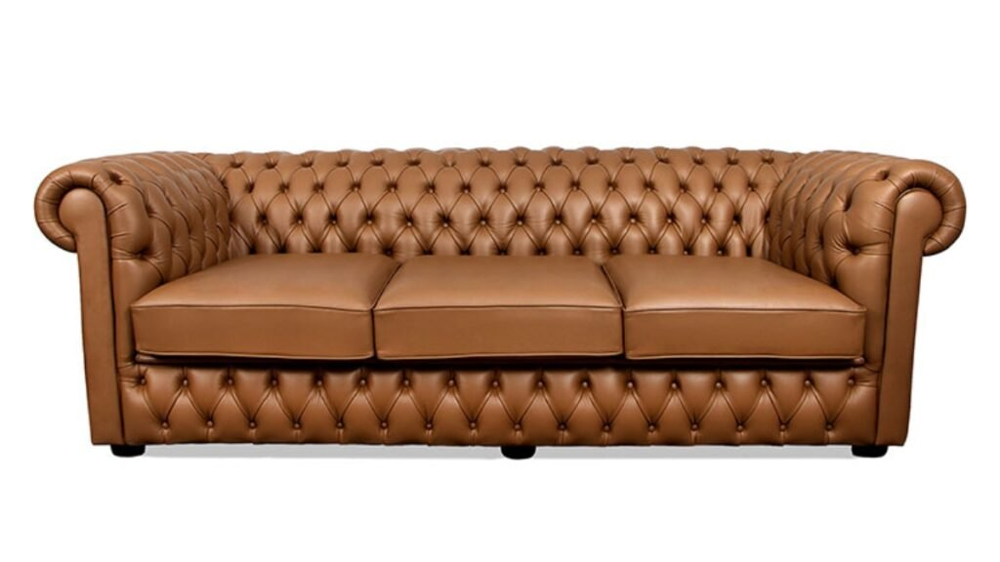

Você já entrou em uma sala e sentiu que um único móvel contava uma história inteira? O **sofá Chesterfield** é exatamente essa peça. Conhecido por seu design imponente e o icônico acabamento em capitonê, ele atravessou séculos como sinônimo de sofisticação.

Aqui no **Irenes**, acreditamos que a paz do lar vem do equilíbrio. E incluir um clássico como este na sua decoração não é apenas sobre estética, é sobre criar um refúgio de conforto e personalidade. Neste guia, vamos te ensinar a escolher, decorar e cuidar do seu Chesterfield, transformando sua sala em um verdadeiro santuário de harmonia.

## **A História por Trás do Ícone: O que é um Sofá Chesterfield?**

A origem do Chesterfield remonta ao século XVIII, na Inglaterra. Diz a lenda que o quarto Conde de Chesterfield, Philip Stanhope, encomendou um sofá onde um cavalheiro pudesse se sentar com as costas retas, sem amassar o seu traje. A história é a mais repetida, mas historiadores admitem que a origem exata do nome não está documentada.

O resultado foi um design único: braços e encosto na mesma altura e o famoso **trabalho em capitonê** (aqueles botões profundos que formam losangos no estofado). Hoje, ele não é mais exclusividade de clubes ingleses, mas um item de desejo em casas que buscam elegância atemporal.

Um detalhe curioso: nos primeiros móveis com capitonê profundo era comum usar veludo, não couro. O couro escuro, que hoje associamos ao Chesterfield, se firmou na era vitoriana, em clubes e escritórios.

A definição clássica é simples: braços e encosto na mesma altura. O capitonê e os braços rolados completam a identidade.

## **Como Identificar um Chesterfield Autêntico**

Para garantir que você está investindo em uma peça de qualidade para o seu lar, fique atenta a estes detalhes:

1.  **O Capitonê:** No modelo original, os botões são presos manualmente à estrutura, criando dobras profundas e simétricas.
    
2.  **Braços Rolados:** As extremidades do sofá costumam ter um formato arredondado, como um pergaminho.
    
3.  **Pés de Madeira:** Geralmente curtos e torneados, muitas vezes com rodinhas de latão, reforçando o estilo vintage.
    
4.  **Material:** Embora o couro legítimo seja o clássico (que envelhece lindamente), versões em veludo e linho trazem uma suavidade perfeita para quem busca um ambiente mais acolhedor e "soft".

## **Versatilidade na Decoração: Do Clássico ao Industrial**

Muitas pessoas hesitam em comprar um Chesterfield por medo de o ambiente ficar "pesado". Mas a verdade é que ele é um camaleão da decoração.

-   **Estilo Industrial:** Combine um Chesterfield de couro marrom ou preto com paredes de tijolinho e iluminação em trilhos. É a combinação perfeita de força e estilo.
    
-   **Clássico e Sereno:** Se você busca a paz que o nome Irene evoca, opte por um Chesterfield em tons neutros, como bege ou cinza claro, em tecidos como o linho.
    
-   **Toque Boho-Chic:** Já pensou em um Chesterfield de veludo verde ou azul marinho? Com algumas almofadas coloridas e plantas ao redor, sua sala ganha uma energia vibrante e, ao mesmo tempo, relaxante.

## **Dicas Práticas: Couro ou Veludo?**

A escolha do material depende da rotina da sua "Irene" interior:

-   **Couro:** Extremamente durável e fácil de limpar (basta um pano úmido). Ideal para quem tem pets ou crianças. Com o tempo, ele ganha uma pátina que o torna ainda mais bonito.
    
-   **Veludo:** Oferece um toque macio e térmico, sendo muito aconchegante para climas mais frios. Exige um pouco mais de cuidado com aspiração e limpeza de manchas.

## **Medidas e Espaço: Cabe na Sua Sala?**

O Chesterfield tem presença visual forte, com encosto alto e braços volumosos. Antes de comprar, faça este teste.

-   **Meça a sala e as passagens:** deixe espaço livre para circular ao redor do sofá.
-   **Meça portas, corredores e elevador:** peças com braços rolados ocupam mais largura do que parecem. Veja se é possível desmontar.
-   **Marque o chão com fita crepe:** isso mostra o espaço real que o sofá vai ocupar.
-   **Pense na parede de fundo:** o sofá fica lindo contra uma parede de cor ou textura. Se quiser usar papel de parede, veja [como calcular a quantidade de papel de parede](/como-calcular-papel-de-parede/).
-   **Em salas pequenas:** escolha um modelo de dois lugares e cores claras, que pesam menos visualmente.

## **Como Cuidar do seu Chesterfield**

Siga sempre a orientação do fabricante ou do estofador. As dicas abaixo valem como cuidados gerais.

-   **Sol e calor:** evite sol direto e fontes de calor próximas, que podem ressecar o couro e desbotar tecidos.
-   **Limpeza de rotina:** no couro, passe um pano macio e levemente úmido. No veludo, aspire com frequência usando bocal macio.
-   **Manchas:** aja rápido e teste qualquer produto em uma área escondida antes.
-   **Capitonê:** a poeira se acumula entre as dobras. Passe o bocal da aspiradora com delicadeza.
-   **Reforma:** estofadores podem reapertar botões e refazer o enchimento de peças antigas.

## **Erros Comuns ao Escolher um Chesterfield**

-   Comprar sem medir o espaço e a entrada do imóvel.
-   Escolher pela foto e não conferir material, estrutura e acabamento.
-   Ignorar a rotina da casa: pets, crianças e sol mudam a melhor escolha de material.
-   Preencher a sala com muitos móveis pesados. Deixe o sofá ser o destaque.
-   Esquecer a combinação com o resto: uma [poltrona em couro](/poltrona-costela-com-puff-em-couro/) pode compor bem com ele.

## **Perguntas Frequentes sobre Sofá Chesterfield**

### Qual a diferença entre Chesterfield e outros sofás com capitonê?

A definição clássica do Chesterfield é ter braços e encosto na mesma altura, além do capitonê e dos braços rolados. Outros sofás com capitonê podem ter alturas diferentes.

### Chesterfield combina com ambiente moderno?

Sim. Em tons neutros ou em veludo colorido, ele contrasta bem com paredes lisas, linhas retas e decoração minimalista.

### Couro ou veludo para quem tem pets?

O couro costuma ser mais fácil de limpar, mas pode riscar. O veludo é mais macio e exige aspiração frequente. Pese a rotina da sua casa.

### O Chesterfield é confortável?

Depende do enchimento e da estrutura. O assento costuma ser firme e o encosto, reto. Teste sentando antes de comprar, se possível.

### Posso usar Chesterfield em sala pequena?

Pode, desde que você meça o espaço. Prefira dois lugares, cores claras e pouca mobília ao redor.

## **Conclusão: O Seu Refúgio de Paz**

Escolher um [sofá Chesterfield](https://osvaldoantiguidades.com.br/produto/poltrona-chesterfield/) é um ato de cuidado com o seu espaço. Ele não é apenas um lugar para sentar, mas o centro das atenções de um lar que valoriza a história e o bem-estar. Seja ele de couro envelhecido ou veludo colorido, o importante é que ele reflita a sua personalidade e traga a harmonia que você merece.

**Gostou dessa inspiração?** Continue navegando no **Irenes.com.br** para descobrir mais dicas de como transformar sua casa e sua rotina com leveza e beleza.

**Leia também:**

- [como aplicar papel de parede adesivo](/como-aplicar-papel-de-parede-adesivo/)
- [como tirar papel de parede](/como-tirar-papel-de-parede/)
- [guia de decoração de interiores](/decoracao-de-interiores/)
